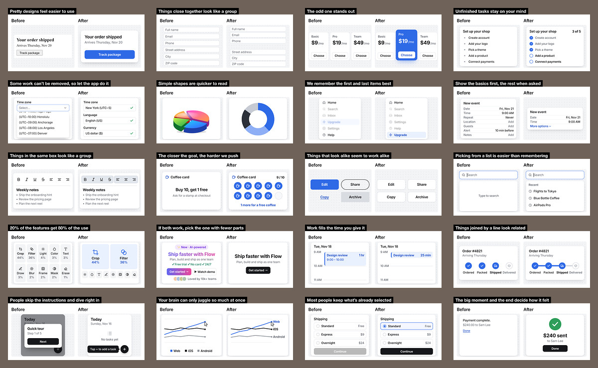

# charles-design-laws



Makes the screens your agent builds easier to use: 20 design laws, as steps it follows whenever it designs or reviews
a screen or a flow.

```bash
npx skills add LemonFace0309/charles-skills --skill charles-design-laws
```

Add `-g` to install it for every project, or copy this folder into `~/.claude/skills/` (Claude Code) or
`~/.agents/skills/` (Codex).

## What it does

- Cuts every part that doesn't help, fills in what the app can work out, and picks defaults that are good for people
- Spaces, boxes and joins things so groups read at a glance, with one thing on each screen that stands out
- Shows people how close they are to done, and ends every flow on a screen that says what happened

Point it at a screen you already have and it reviews it instead: what's missing, then a table of what breaks each law,
where, and the fix.

## Try it

```text
/charles-design-laws the signup flow for my habit tracker
/charles-design-laws review my settings screen, why does it feel so confusing? settings.png
```

## Needs

Nothing beyond your agent. To review a screen it didn't build, give it a screenshot or the code.

## Pairs with

[charles-ux-animation](../charles-ux-animation/) for how the screen moves and responds, and six more laws: Fitts's,
Hick's, Miller's, Jakob's and Postel's laws and the Doherty threshold. [charles-unslop](../../design/charles-unslop/)
first if the screen looks AI-made, [charles-design-tips](../charles-design-tips/) for the type, colour and spacing
fixes inside each part, and [charles-polish](../../design/charles-polish/) for the last pass on states and details.

## Credits

17 of the 20 are laws on Jon Yablonski's [Laws of UX](https://lawsofux.com), and recognition over recall comes from its
page on working memory. Progressive disclosure follows Jakob Nielsen's
[article on it](https://www.nngroup.com/articles/progressive-disclosure/), and the default effect comes from Eric
Johnson and Daniel Goldstein's 2003 study of organ-donor defaults. 15 of the 20 also have a rule in Raphael Salaja's
[userinterface.wiki](https://www.userinterface.wiki) skill, which this skill builds on.
