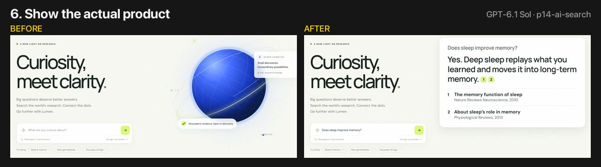
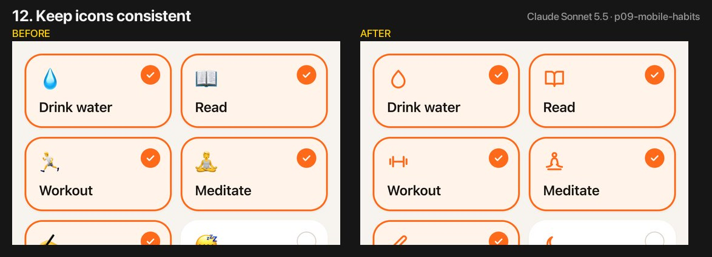
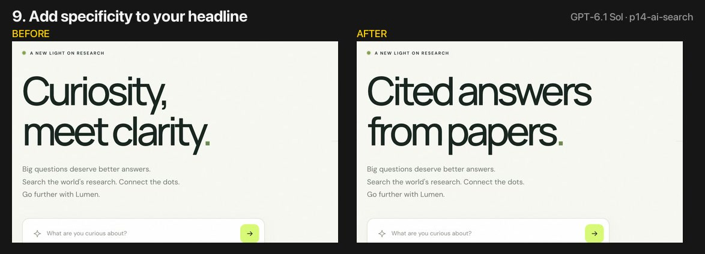

# charles-unslop



Turns a screen that looks AI-made into one with its own point of view.

```bash
npx skills add LemonFace0309/charles-skills --skill charles-unslop
```

Add `-g` to install it for every project, or copy this folder into `~/.claude/skills/` (Claude Code) or
`~/.agents/skills/` (Codex).

## What it does

- Finds the tells: glows, emoji icons, pill badges, generic headlines
- Deletes what doesn't earn its place, then fixes spacing, colour, icons, copy and type, in that order
- Gives the screen one moment only that product could have

## Examples

Fixes from my "20 Ways to Unslop AI Designs" reel, on pages that AI models built. The one at the top is "show the
actual product".





## Try it

```text
/charles-unslop this login page
/charles-unslop review the dashboard an agent just built
```

## Pairs with

[charles-polish](../charles-polish/) once the screen looks designed and you want it to feel finished.

## Credits

Adapted from [unslop](https://github.com/heydamir/unslop) by Damir Sokolovsky, and draws on Emil Kowalski's unslop
design skill. Like the original, this skill is under CC BY 4.0.
